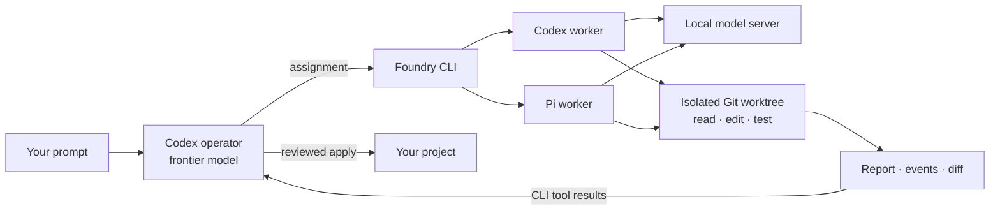

# Frontier Foundry

**Frontier models plan and review. Local models write and test the code.**

Frontier Foundry lets a Codex operator delegate implementation to a local model
running in **Codex or Pi**, then bring its report and code changes back into the
same operator session. Pick the harness that works with your model server.

A small Python CLI connects the processes over stdio. No MCP server, agent SDK,
message broker, or extra daemon is required by the bridge.



- **Opt in per project.** Invoke `$spark-workers` explicitly; ordinary Codex
  prompts and native subagents keep their normal behavior.
- **Mix worker harnesses.** Use a project default or select a worker per job.
- **Keep work reviewable.** Each job has a private worktree, report, event logs,
  cancellation, and follow-up in the same worker conversation.
- **Stay lightweight.** Python's standard library, Git, and your existing tools.
  One worker inference turn runs at a time within a state directory.

## Requirements

- Linux, Python 3.11+, and Git. Enabled projects need an initial commit.
- Codex CLI authenticated for your frontier operator.
- At least one worker harness and a tool-capable model endpoint:

| Worker | Model API | Execution permissions |
| --- | --- | --- |
| Codex | Responses API with streaming and tool continuation | `workspace-write` by default; explicit full access available |
| Pi | A custom provider supported by Pi, including OpenAI-compatible Chat Completions | Explicit `danger-full-access` required; no built-in workspace sandbox |

The tested baseline is **Codex 0.163.0 and Pi 1.1.0 on Linux ARM64**. Harness
protocols change; rerun a small live task after upgrading. Foundry does not
install model weights, serve models, or translate Chat Completions into Responses.

## Install

```sh
gh repo clone Nick5893/frontier-foundry
cd frontier-foundry
python3 install.py
export PATH="$HOME/.local/bin:$PATH"
foundry --version
```

Repository access is required while this repo is private. Installation creates
`foundry`, its compatibility alias `spark-workers`, and the optional Codex helpers
`foundry-adapter` and `foundry-catalog`. It leaves global Codex configuration,
other projects, and shell startup files alone.

For a preview alongside another installation, use
`python3 install.py --prefix /path/to/preview` and that prefix's `bin/foundry`.
Conflicting commands are refused unless you explicitly pass `--force`.

## Quick start

### 1. Register a worker

**Pi + a Chat Completions endpoint**

Create a private `models.json` using [examples/pi-models.json](examples/pi-models.json).
Set its base URL and model ID to values accepted by your server. Then register it:

```sh
foundry configure --worker pi-local --harness pi \
  --models /absolute/path/to/models.json \
  --provider local --model local-worker
```

Pi workers get a private configuration directory with only the selected provider
and model. Automatic extensions, MCP connections, skills, prompt templates,
context-file loading, and startup network checks are disabled. The worker is
instructed to read applicable `AGENTS.md` files itself. Your interactive Pi
installation and sessions are left alone. Pi connects directly to its provider;
the Codex tool adapter is unnecessary on this path.

**Codex + an existing local Responses profile**

```sh
foundry configure --profile /absolute/path/to/worker.config.toml
```

This registers `codex-local`, the default worker when no project choice is saved.
For a fresh Codex setup, see [local backend setup](docs/local-backend.md) for
catalog generation and the optional freeform/namespaced tool adapter.

### 2. Enable a project

```sh
cd /path/to/your/git-project

# Choose one:
foundry enable --worker codex-local
foundry enable --worker pi-local --sandbox danger-full-access

foundry doctor
```

Pi requires the explicit full-access selection. **A Git worktree isolates changes
for review; it is not a security sandbox.** Full-access tools can read and write
outside the worktree. Foundry never downgrades `workspace-write` to full access.

### 3. Open Codex and give it work

```sh
foundry run "Implement CSV export for the report command and verify it."
```

Or open a fresh normal Codex session in the enabled project and type:

```text
$spark-workers Implement CSV export for the report command and verify it.
```

The operator reads the project, plans, submits implementation assignments,
collects results, reviews diffs, requests corrections, and applies verified work.
Worker reports and diffs appear as CLI tool results in Codex; these external jobs
do not appear as native Codex subagents and do not push unsolicited completion
messages into the conversation.

`foundry run` preserves the operator's usual model and permissions. Use
`--model MODEL_ID` to select an operator model, or `--full-access` when you
explicitly want full access for that operator session as well. Worker and
operator permissions are separate choices.

## Mix harnesses in one project

Register both workers, then select one per assignment:

```sh
foundry submit --worker pi-local --name implement --prompt-file /tmp/task.md
foundry submit --worker codex-local --name investigate --prompt-file /tmp/check.md
```

The project must permit the selected worker's execution mode. Independent jobs
can queue together; submit dependent work after integrating its prerequisites.
There is no automatic task router or parallel GPU scheduler.

A submitted job freezes its harness, binary path, model configuration, and
permission mode. Follow-ups keep that worker, conversation, and worktree even if
you change the registered default later. Executable upgrades, external auth
helpers, environment credentials, and referenced catalog files remain external
dependencies; Foundry does not vendor or lock their contents.

## Inspect, correct, and apply

```sh
foundry status
foundry wait JOB_ID --seconds 30
foundry result JOB_ID
foundry diff JOB_ID --stat
foundry diff JOB_ID
foundry followup JOB_ID --prompt-file /tmp/correction.md
foundry apply JOB_ID
foundry cancel JOB_ID
```

`submit` also accepts text or `--prompt-file -` for stdin. Commands accept
`--project /absolute/path/to/project`. `wait` returns within 60 seconds while the
job continues; `submit --timeout SECONDS` limits an inference turn (default 1800,
maximum 3600).

Snapshots include staged, unstaged, and non-ignored untracked files without
changing the user's index. Ignored dependencies and secrets are not copied
unless already tracked. `apply` checks for conflicts and applies the worker delta
without staging. Review first and run acceptance checks afterward: a completed
model turn is not proof of correct code. Applied jobs cannot be followed up.

```sh
foundry enable --update   # Refresh project skill; preserve worker and mode
foundry disable           # Finish/cancel active jobs first; retain saved work
```

For a persistent terminal: `tmux new-session -s foundry`, then open Codex inside.
Reconnect with `tmux attach -t foundry`. Workers persist independently of tmux.

## Configuration and privacy

Foundry writes its own settings to `~/.config/frontier-foundry/config.toml`:

```toml
[workers.codex-local]
harness = "codex"
profile = "/absolute/path/to/worker.config.toml"
binary = "/absolute/path/to/codex"

[workers.pi-local]
harness = "pi"
models = "/absolute/path/to/models.json"
provider = "local"
model = "local-worker"
binary = "/absolute/path/to/pi"
```

Prefer `configure` to editing this file. `--codex PATH` or `--pi PATH` selects an
executable. `configure --health-url ''` disables the optional health request for
a worker without that route. `doctor --worker NAME` checks an alternate worker;
health does not establish inference or tool compatibility.

Existing single-worker settings and jobs remain compatible. Environment
variables `SPARK_WORKERS_CONFIG`, `SPARK_WORKERS_STATE_DIR`,
`SPARK_WORKERS_PROFILE`, and `SPARK_WORKERS_CODEX` remain supported; the latter
two select the default Codex worker. Native delegation and global skills are
unchanged. `$spark-workers` retains its name for compatibility.

Assignments, private configuration copies, sessions, tool outputs, and logs live
under `~/.local/state/spark-workers`. Keep them private. Prefer environment
references for credentials; Pi's interactive `auth.json` is not copied. Local
inference uses your configured endpoint, while reports and diffs read by the
frontier operator enter that operator's model context.

MCP-free transport still requires permission to run local subprocesses and reach
the model endpoint. It does not bypass an organization's execution restrictions.

## Tests and development

```sh
python3 -m unittest discover -s tests -v
python3 -m py_compile spark_workers.py worker_harnesses.py spark_proxy.py make_model_catalog.py install.py
```

The automated suite needs no GPU, model weights, or API keys. It tests both
installed worker paths, session resume, frozen configuration, permissions,
provider checks, failure and cancellation behavior, Unicode JSONL, Git isolation,
conflicts, and Codex tool translation. See [validation evidence](docs/validation.md)
for the live model smoke test and [contributing](CONTRIBUTING.md) for development.

## Documentation

- [Architecture and lifecycle](docs/architecture.md)
- [Local backend setup](docs/local-backend.md)
- [Adding another harness](docs/harness-agnostic-scope.md)
- [Troubleshooting](docs/troubleshooting.md)
- [Codex app-server protocol](https://learn.chatgpt.com/docs/app-server)
- [Pi RPC protocol](https://github.com/earendil-works/pi/blob/main/packages/coding-agent/docs/rpc.md)
