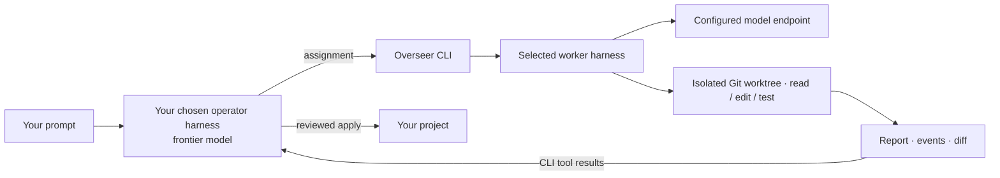

# Overseer

<p align="center">
  
</p>

**Frontier models plan and review. Local models write and test the code.**

Overseer connects your chosen orchestrator to local coding workers. Any coding
harness that can run shell commands and access the project filesystem can act as
the operator: plan assignments, dispatch work, read reports and diffs, request
corrections, and integrate the results in the same session.

Choose the two sides independently. Your operator uses the harness and model you
prefer; workers run in **Codex, Pi, OMP, OpenCode, or Claude Code** against your
configured model endpoint. For example, a Claude Code operator could delegate to
Codex/Qwen workers, or a Codex operator could use Pi workers.

A small Python CLI connects the processes over stdio. No MCP server, agent SDK,
message broker, or extra daemon is required by the bridge.



- **Choose your orchestrator.** The operator calls the CLI through its shell tool;
  no operator-specific bridge adapter is required.
- **Opt in per project.** Request Overseer explicitly. Your harness's usual
  delegation stays unchanged; Codex users can invoke the supplied `$overseer` skill.
- **Mix worker harnesses.** Use a project default or select a worker per job.
- **Keep work reviewable.** Each job has a private worktree, report, event logs,
  cancellation, and follow-up in the same worker conversation.
- **Stay lightweight.** Python's standard library, Git, and your existing tools.
  One worker inference turn runs at a time within a state directory.

## Requirements

- Linux, Python 3.11+, and Git. Enabled projects need an initial commit.
- An operator harness with shell execution and access to the same Linux project
  filesystem and Overseer state. Configure its model and authentication normally.
- At least one worker harness and a tool-capable model endpoint:

| Worker | Model API | Execution permissions |
| --- | --- | --- |
| Codex | Responses API with streaming and tool continuation | `workspace-write` by default; explicit full access available |
| Pi | A custom provider supported by Pi, including OpenAI-compatible Chat Completions | Explicit full access |
| OMP (Oh My Pi) | OpenAI-compatible Chat Completions through its custom provider configuration | Explicit full access |
| OpenCode | OpenAI-compatible Chat Completions | Explicit full access |
| Claude Code | Anthropic Messages API, directly or through a compatible gateway | Explicit full access |

The tested baseline is **Codex 0.163.0, Pi 1.1.0, OMP 18.12.4, OpenCode 2.0.16,
and Claude Code 2.1.304 on Linux ARM64**. Harness
protocols change; rerun a small live task after upgrading. Overseer does not
install model weights, serve models, or translate Chat Completions into Responses.

## Install

```sh
gh repo clone Nick5893/overseer
cd overseer
python3 install.py
export PATH="$HOME/.local/bin:$PATH"
overseer --version
```

Installation creates `overseer` and the optional Codex helpers `overseer-adapter` and
`overseer-catalog`. It leaves global harness configuration, other projects, and
shell startup files alone.

For a preview alongside another installation, use
`python3 install.py --prefix /path/to/preview` and that prefix's `bin/overseer`.
Conflicting commands are refused unless you explicitly pass `--force`.

## Updating an existing installation

Reinstall from an updated checkout to update the CLI. Existing configuration,
task state, opt-in markers, and compatibility commands are preserved. The
checkout directory can keep its existing name.

For Codex, `$overseer` is the explicit project skill.
Refresh an enabled project's skills with `overseer enable --update`. Older
projects can still launch through their existing skill until refreshed. Global
harness settings and native delegation stay unchanged.

## Configure from the CLI

```sh
overseer setup             # Interactive: choose harness, endpoint, model, credentials
overseer workers           # List workers and executable availability
overseer configure --help  # Scriptable configuration options
```

`setup` registers a worker in Overseer's private configuration. It does not install
a harness, enable a project, or change operator defaults. Install the worker
harness separately, or pass its executable with `--binary PATH`. Credential prompts
ask for an environment variable **name**, never a secret value.

For a local Chat Completions server, the same short configuration works with
Pi, OMP, or OpenCode:

```sh
overseer configure --harness opencode --worker code-local \
  --base-url http://127.0.0.1:18888/v1 --model local-worker
```

Use `--harness pi` or `--harness omp` to choose another harness. For an authenticated
endpoint, add `--api-key-env LOCAL_MODEL_API_KEY` and provide that variable in the
shell that starts Overseer. For Pi/OMP/OpenCode, `--context-window` and
`--max-tokens` default to 32768 and 4096; set them to limits your server supports.

Claude Code requires an Anthropic-compatible Messages endpoint:

```sh
overseer configure --harness claude --worker claude-local \
  --base-url http://127.0.0.1:18888 --model local-worker \
  --api-key-env LOCAL_MODEL_API_KEY --auth-mode bearer
```

Use `--auth-mode api-key` (the default) for endpoints expecting Anthropic's API-key
header. `claude-code` is also accepted as a harness name. Claude workers use bare
headless mode, a private configuration directory, an explicit tool allowlist, and
empty strict MCP configuration. They use the configured endpoint rather than
importing your interactive subscription login. Non-Claude models through a gateway
are [outside Anthropic's support](https://code.claude.com/docs/en/llm-gateway);
validate the model/API combination with the live smoke test.

## Quick start

### 1. Register a worker (or use `overseer setup`)

**Pi + a Chat Completions endpoint**

Create a private `models.json` using [examples/pi-models.json](examples/pi-models.json).
Set its base URL and model ID to values accepted by your server. Then register it:

```sh
overseer configure --worker pi-local --harness pi \
  --models /absolute/path/to/models.json \
  --provider local --model local-worker
```

Pi workers get a private configuration directory with only the selected provider
and model. Automatic extensions, MCP connections, skills, prompt templates,
context-file loading, and startup network checks are disabled. The worker is
instructed to read applicable `AGENTS.md` files itself. Your interactive Pi
installation and sessions are left alone. Pi connects directly to its provider;
the Codex tool adapter is unnecessary on this path.

**Codex + an existing local Responses profile**

```sh
overseer configure --profile /absolute/path/to/worker.config.toml
```

This registers `codex-local`, the default worker when no project choice is saved.
For a fresh Codex setup, see [local backend setup](docs/local-backend.md) for
catalog generation and the optional freeform/namespaced tool adapter.

### 2. Enable a project

```sh
cd /path/to/your/git-project

# Choose one:
overseer enable --worker codex-local
overseer enable --worker pi-local --sandbox danger-full-access

overseer doctor
```

Pi, OMP, OpenCode, and Claude Code require the explicit full-access selection.
This bridge does not provide Codex-equivalent workspace sandboxing for them. **A Git worktree isolates changes
for review; it is not a security sandbox.** Full-access tools can read and write
outside the worktree. Overseer never downgrades `workspace-write` to full access.

### 3. Open your chosen orchestrator and give it work

Start your operator harness in the enabled project. Put the following workflow
in its project instructions or include it with your prompt:

```text
Use the Overseer CLI for local implementation workers. Consult overseer --help
and each subcommand's --help for arguments. Run overseer doctor,
inspect the project, and plan self-contained assignments with acceptance checks.
Submit each assignment with overseer submit --prompt-file PATH. Collect results
with overseer wait, overseer result, and overseer diff. Review the actual changes
and test evidence; use overseer followup for corrections. Apply reviewed work
with overseer apply, then verify it in the original project. Queue independent
assignments together; integrate prerequisites before submitting dependent work.
Keep the configured worker and permissions; report failures rather than silently
switching providers. Do not substitute your harness's native subagents.

Task: Implement CSV export for the report command and verify it.
```

Worker reports and diffs return as shell tool output in your operator's session.
The operator collects them through the CLI; the bridge does not register jobs in
the harness's native subagent panel or push completion notifications into its
conversation. No MCP connection is needed.

**Codex convenience integration.** The installer supplies an explicit project
skill, and `overseer run` launches Codex with that skill:

```sh
overseer run "Implement CSV export for the report command and verify it."
```

Or open a fresh normal Codex session in the enabled project and type:

```text
$overseer Implement CSV export for the report command and verify it.
```

`overseer run` is currently a Codex launcher, not a selector for other operator
harnesses. It preserves your usual Codex model and permissions. Use
`--model MODEL_ID` to select its model, or `--full-access` for that operator
session. For another operator, launch its own CLI normally and use the workflow
above. Worker and operator permissions are separate choices.

## Delegate multiple assignments

One operator can manage several local worker jobs. Your chosen harness can plan
a feature and submit three assignments to workers using the same configured
Qwen endpoint. Each job has its own assignment, conversation, Git worktree,
report, logs, and diff. Corrections resume that job's
saved conversation and worktree.

**Jobs queue; one local worker runs at a time within a shared state directory.**
Submitting three jobs creates three separate worker conversations. They execute
one at a time, and queue order is not guaranteed. This limit applies
across enabled projects sharing that state directory; it does not control other
clients of your model server.

After registering a Qwen worker and enabling the project, give your operator the
workflow above and a task such as:

```text
Use Overseer to split this feature into three independent assignments using the
project's configured Qwen worker. Review each result, request corrections where
needed, and verify the integrated changes.
```

The operator collects reports and diffs through CLI commands in its own
conversation, then reviews and applies the changes. Independent jobs may be
submitted together. If one assignment needs another's changes, integrate the prerequisite before
submitting the dependent job so it starts from the updated project.

## Mix harnesses in one project

Register both workers, then select one per assignment:

```sh
overseer submit --worker pi-local --name implement --prompt-file /tmp/task.md
overseer submit --worker codex-local --name investigate --prompt-file /tmp/check.md
```

You can use `--worker` with any registered harness, including OMP, OpenCode, and
Claude Code. The project must permit the selected worker's execution mode. Independent jobs
can queue together; submit dependent work after integrating its prerequisites.
There is no automatic task router or parallel GPU scheduler.

A submitted job freezes its harness, binary path, model configuration, and
permission mode. Follow-ups keep that worker, conversation, and worktree even if
you change the registered default later. Executable upgrades, external auth
helpers, environment credentials, and referenced catalog files remain external
dependencies; Overseer does not vendor or lock their contents.

## Inspect, correct, and apply

```sh
overseer status
overseer wait JOB_ID --seconds 30
overseer result JOB_ID
overseer diff JOB_ID --stat
overseer diff JOB_ID
overseer followup JOB_ID --prompt-file /tmp/correction.md
overseer apply JOB_ID
overseer cancel JOB_ID
```

`submit` also accepts text or `--prompt-file -` for stdin. Commands accept
`--project /absolute/path/to/project`. `wait` returns within 60 seconds while the
job continues; `submit --timeout SECONDS` limits an inference turn (default 1800,
maximum 3600).

Snapshots include staged, unstaged, and non-ignored untracked files without
changing the user's index. Ignored dependencies and secrets are not copied
unless already tracked. `apply` checks for conflicts and applies the worker delta
without staging. Review first and run acceptance checks afterward: a completed
model turn is not proof of correct code. Applied jobs cannot be followed up.

```sh
overseer enable --update   # Refresh project skill; preserve worker and mode
overseer disable           # Finish/cancel active jobs first; retain saved work
```

For a persistent terminal: `tmux new-session -s overseer`, then open your operator
harness inside.
Reconnect with `tmux attach -t overseer`. Workers persist independently of tmux.

## Configuration and privacy

Overseer keeps its own private settings file. Run `overseer workers` to see its
location in the `config` field. A configuration with two registered workers looks
like this:

```toml
[workers.codex-local]
harness = "codex"
profile = "/absolute/path/to/worker.config.toml"
binary = "/absolute/path/to/codex"

[workers.pi-local]
harness = "pi"
models = "/absolute/path/to/models.json"
provider = "local"
model = "local-worker"
binary = "/absolute/path/to/pi"
```

Prefer `configure` to editing this file. `--codex PATH` or `--pi PATH` selects an
executable. `configure --health-url ''` disables the optional health request for
a worker without that route. `doctor --worker NAME` checks an alternate worker;
health does not establish inference or tool compatibility.

Existing single-worker settings and jobs remain compatible. Environment overrides
are `OVERSEER_CONFIG`, `OVERSEER_STATE_DIR`, `OVERSEER_PROFILE`, and
`OVERSEER_CODEX`. Profile and Codex executable overrides select the
default Codex worker. Native delegation and global skills stay unchanged.

Assignments, private configuration copies, sessions, tool outputs, and logs live
in Overseer's state directory. `OVERSEER_STATE_DIR` overrides its location;
`overseer result JOB_ID` includes paths to the job's workspace and evidence. Keep
this state private. Prefer environment
references for credentials; Pi's interactive `auth.json` is not copied. Local
inference uses your configured endpoint, while reports and diffs read by the
frontier operator enter that operator's model context.

MCP-free transport still requires permission to run local subprocesses and reach
the model endpoint. It does not bypass an organization's execution restrictions.

## Tests and development

```sh
python3 -m unittest discover -s tests -v
python3 -m compileall -q .
```

The automated suite needs no GPU, model weights, or API keys. It tests all five
installed worker paths, session resume, frozen configuration, permissions,
provider checks, failure and cancellation behavior, Unicode JSONL, Git isolation,
conflicts, and Codex tool translation. See [validation evidence](docs/validation.md)
for the live model smoke test and [contributing](CONTRIBUTING.md) for development.

## Documentation

- [Architecture and lifecycle](docs/architecture.md)
- [Local backend setup](docs/local-backend.md)
- [Harness support and compatibility](docs/harnesses.md)
- [Adding another harness](docs/harness-agnostic-scope.md)
- [Troubleshooting](docs/troubleshooting.md)
- [Codex app-server protocol](https://learn.chatgpt.com/docs/app-server)
- [Pi RPC protocol](https://github.com/earendil-works/pi/blob/main/packages/coding-agent/docs/rpc.md)

## License

The code and documentation are licensed under the [MIT License](LICENSE).
The third-party [Vault Boy artwork](assets/README.md) is excluded from that license.
