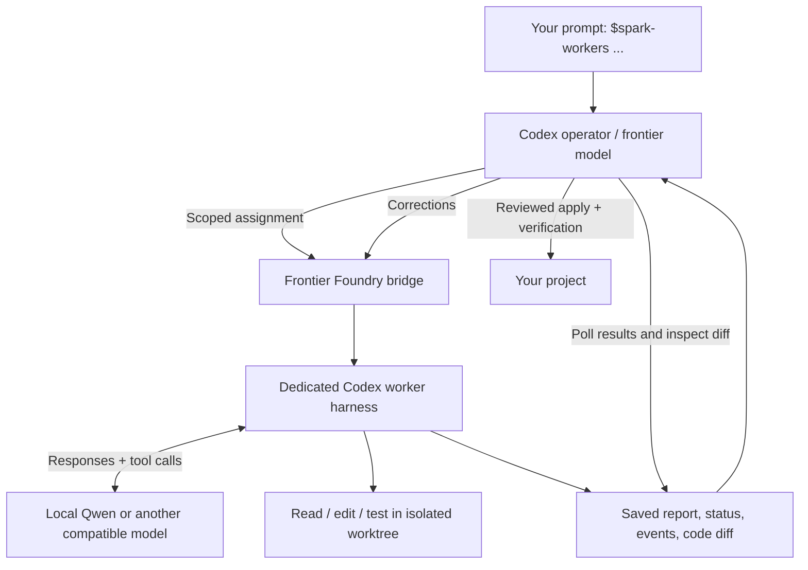

# Frontier Foundry

**Let a frontier model direct the work. Let your local model build it.**

Frontier Foundry connects an OpenAI-powered Codex operator to local coding workers
running inside their own Codex harnesses. The operator reads your prompt, inspects
the project, plans the work, delegates implementation, reviews the returned code,
and asks for corrections or integrates the result.

The local model gets real tools: it can read files, edit code, and run tests.
This is a worker execution bridge, rather than a prompt that asks a local model
to suggest code. The bridge handles sessions, queueing, isolated Git worktrees,
reports, cancellation, follow-up, and patch application.



**Project opt-in and explicit invocation are both required.** Normal Codex
delegation stays the default. The historical skill name `$spark-workers` and
command `spark-workers` remain supported; `foundry` is the shorter CLI alias.

## Requirements

- Linux and Python 3.11+; the supervisor uses Linux `/proc` and file locks.
- Git, with an initial commit in each project you enable.
- Codex CLI installed and authenticated for the frontier model you want as operator.
- A local tool-capable model server supporting **`POST /v1/responses`**, streaming,
  function tools, and tool-result continuation. Chat Completions support alone is
  insufficient.
- Enough context and memory for the worker harness. Set the advertised context
  window to the actual limit your model server supports.

The original integration used Codex CLI **0.163.0** on an ARM64 Linux Spark
machine with a local Qwen model. The app-server protocol and model catalog can
change between Codex versions; validate a small task after upgrading. The
automated suite runs without model weights, a GPU, or an OpenAI API key.

## Install

This is a private repository. The person installing it needs repository access.

```sh
gh repo clone Nick5893/frontier-foundry
cd frontier-foundry
python3 install.py
export PATH="$HOME/.local/bin:$PATH"
foundry --version
```

The installer copies only the runtime and skill templates into
`~/.local/share/frontier-foundry` and creates four commands in `~/.local/bin`:
`foundry`, `spark-workers`, `foundry-adapter`, and `foundry-catalog`. Python's
standard library is sufficient; there are no pip dependencies for the bridge.
It does not edit your shell startup files, global Codex configuration, or projects.

If a command already belongs to another installation, installation stops before
replacing it. To try this alongside an existing Spark bridge, use
`python3 install.py --prefix /path/to/preview-prefix` and put its `bin` directory
on PATH in a test shell. Use `--force` only when intentionally replacing the old
command links. Model serving software is installed separately.

## Connect the local worker

If you already have a working Codex profile for your local model:

```sh
foundry configure --profile /absolute/path/to/your-worker.config.toml
```

The profile must specify `model`, a custom `model_provider`, and that provider's
`base_url` and `wire_api = "responses"`. Foundry reads the model name from this
profile; it is not limited to a hardcoded Qwen alias. Your existing local
authentication command or environment-based provider authentication can stay in
that profile. Credentials are not part of this repository.

For a fresh setup, start your tool-capable local server with the served alias
`local-worker` on loopback port **18888**. Use its documented, model-specific
tool and reasoning parser configuration. Then start the included adapter in
another terminal:

```sh
foundry-adapter --port 18991 --upstream-port 18888
```

The adapter translates Codex freeform/namespaced tools into ordinary function
calls and translates the results back. It does not convert a Chat Completions
server into a Responses server or supply a missing tool parser.

Generate the worker catalog and profile from your installed Codex binary:

```sh
foundry-catalog \
  --model local-worker \
  --context-window 65536 \
  --output "$HOME/.codex/local-worker-models.json" \
  --profile-output "$HOME/.codex/local-worker.config.toml"

foundry configure --profile "$HOME/.codex/local-worker.config.toml"
```

Use **your backend's real context limit**, not an assumed larger value. The
catalog helper reads Codex's bundled metadata locally; it performs no inference,
downloads no model weights, and refuses to overwrite existing files.

See [local backend setup](docs/local-backend.md) for authentication, direct
endpoints, existing Spark profiles, and troubleshooting. A hand-editable
[profile example](examples/local-worker.config.toml) is also included.

## Use it on a project

Inside a Git project with at least one commit:

```sh
cd /path/to/your/project
foundry enable
foundry doctor
foundry run "Implement CSV export for the report command and verify it."
```

`run` opens your normal Codex CLI with `$spark-workers` explicitly mentioned in
the prompt. It preserves your normal operator model unless you pass
`--model MODEL_ID`. You can also open a fresh Codex session yourself and type:

```text
$spark-workers Implement CSV export for the report command and verify it.
```

The skill is installed only in that project's `.agents/skills/spark-workers/`,
with `allow_implicit_invocation: false`. Eligibility and the worker execution
mode live in `.codex/spark-workers.json`. An ordinary prompt in an enabled
project still uses normal Codex behavior. No global skill or replacement native
subagent role is installed.

For a persistent operator terminal, start `tmux new-session -s foundry` first,
then run the project commands inside it. Detach with Ctrl+B, then D, and return
with `tmux attach -t foundry`. Worker task state is saved independently of tmux.

### Permissions on hosts where sandboxing is unavailable

New projects use `workspace-write` worker sandboxing by default. There is **no
automatic fallback to full access**. If you deliberately want the original
Spark host's full-access workflow:

```sh
foundry enable --sandbox danger-full-access
foundry run --full-access "Implement the feature and verify it."
```

These are two explicit choices: `enable --sandbox` selects worker permissions;
`run --full-access` selects permissions for that launched operator session too.
An existing Codex session keeps its selected permissions. Full-access commands
can reach files outside their worktree; a Git worktree is an integration boundary,
not a security sandbox.

## What the operator does

The project skill instructs Codex to inspect the repository and plan, give each
worker a scoped assignment with acceptance checks, collect its report and actual
diff, request corrections, apply reviewed completed work, and verify the result.
That is an instruction workflow, not a programmatic proof that the operator
performed every review step. A completed worker turn alone does not mean the
implementation is correct.

The local workers are separate Codex sessions managed by the bridge. They are
not native cross-provider `spawn_agent` children. Their own native delegation is
disabled to avoid recursion. The standard native Codex subagent architecture is
left alone. The bridge currently runs **one worker inference turn at a time**;
independent assignments can queue, and dependent tasks should be submitted after
their prerequisites have been integrated.

## Inspect or manage jobs yourself

```sh
foundry submit --name csv-export --prompt-file examples/assignment.md
foundry status
foundry wait JOB_ID --seconds 30
foundry result JOB_ID
foundry diff JOB_ID --stat
foundry diff JOB_ID
foundry followup JOB_ID --prompt-file /tmp/correction.md
foundry apply JOB_ID
foundry cancel JOB_ID
```

Use an assignment file relevant to the **enabled project**, or pass text directly
or `--prompt-file -` for stdin. The sample assignment is a template, not a feature
implemented in this bridge. Commands accept `--project /absolute/project/path`
when invoked from another directory. `submit --timeout SECONDS` controls the turn
limit (default 1800, maximum 3600). `wait` returns after at most 60 seconds while
the worker keeps running. See [architecture and lifecycle](docs/architecture.md)
for what is saved, how results return to the operator, and recovery behavior.

To remove a project's integration:

```sh
foundry disable
```

Finish or cancel active jobs first. Existing worktrees and logs are retained.
After a bridge update, `foundry enable --update` refreshes the project skill and
preserves its permission choice.

## Configuration

`foundry configure` writes only `~/.config/frontier-foundry/config.toml`:

```toml
worker_profile = "/absolute/path/to/local-worker.config.toml"
# Optional:
# codex_binary = "/absolute/path/to/codex"
# state_dir = "/absolute/path/to/private-worker-state"
# health_url = "http://127.0.0.1:18991/health"
```

Environment overrides are `SPARK_WORKERS_CONFIG`, `SPARK_WORKERS_PROFILE`,
`SPARK_WORKERS_CODEX`, and `SPARK_WORKERS_STATE_DIR`. Without configuration,
Foundry looks for `codex` on PATH and a worker profile at
`~/.codex/spark.config.toml`, if it exists, otherwise
`~/.codex/local-worker.config.toml`. `configure --health-url ''` skips the health
request for backends without that route. Health checks do not verify inference
or tool compatibility.

## Development and validation

```sh
python3 -m unittest discover -s tests -v
python3 -m py_compile spark_workers.py spark_proxy.py make_model_catalog.py install.py
```

The suite covers opt-in boundaries, dirty snapshot/index preservation, conflict
handling, provider identity checks, worker lifecycle, isolated harness state,
installer behavior, and streaming tool translation. The integration test uses a
small fake JSONL harness so it is runnable on a machine without the local model.
The original bridge was also tested with live Qwen edits, test execution,
follow-up, cancellation, and reviewed patch application. Validate your own model
with a small disposable project before assigning substantial work.

The live model and serving services are separate dependencies. This repository
contains no credentials, personal Codex profiles, conversations, model weights,
or Lineup project files. Local inference stays on the configured endpoint;
reports and diffs read by the frontier operator enter that operator's model
context. Runtime logs can contain task content and belong in private local state.

Official protocol references: [Codex app-server](https://learn.chatgpt.com/docs/app-server),
[configuration reference](https://learn.chatgpt.com/docs/config-file/config-reference),
and [explicit skill invocation](https://learn.chatgpt.com/docs/build-skills).
